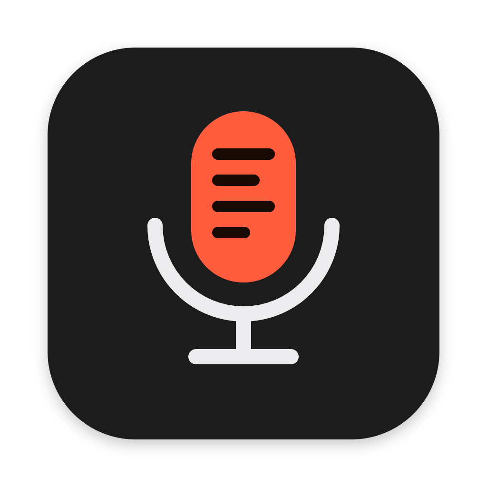

<p align="center"></p>

<h1 align="center">Wordfall</h1>

<p align="center">Hold <kbd>fn</kbd>, speak, let go. Your words appear wherever your cursor is.<br>
Local speech recognition for macOS and Windows. Nothing leaves your computer.</p>

---

- **Push to talk anywhere.** Hold <kbd>fn</kbd> (Windows: <kbd>Right Ctrl</kbd>, or another right-hand modifier)
  in any app; release to paste. Double-tap for hands-free, <kbd>esc</kbd> to cancel.
- **Speaks your languages.** Pick the languages you dictate in (English and your system language by
  default). Each dictation is written in whichever of them you spoke; no switching, and short phrases
  don't flip to a language you don't speak.
- **Clean text.** Drops um, uh, äh, ähm. Say "first, … second, …" / "erstens, … zweitens, …" for a
  numbered list, "bullet point …" / "Stichpunkt …" for a bulleted one.
- **On-device Whisper.** whisper.cpp with Metal on macOS, Vulkan (any recent GPU) on Windows. Large v3 Turbo by
  default; switch models in Settings.
- **Fast.** About 0.7 s from release to text for a typical dictation on an M-series Mac (about 0.1 s more
  when it also has to tell your languages apart, up to about 0.7 s more when that's a close call). On Windows
  with a desktop GPU about 0.1–0.4 s (RTX 5070 Ti, 7–38 s clips).
- **Gets your words right.** A dictionary of replacements (“post gress” → “PostgreSQL”), words to
  recognise, and suggestions learned from your transcripts.
- **Meeting notes.** Start a meeting from *Meetings*: Wordfall records you and the other participants (the
  computer's audio, so Zoom, Teams and Meet work with headphones), transcribes as it goes, tells speakers apart,
  and writes notes with decisions and action items when you stop, with a language model that runs on your
  computer. Jot down your own notes during the meeting and the notes are built around them. While you talk, it
  proposes questions to ask, steered by the meeting's goal, in a small window that stays above the call, and draws a
  rough map of the systems and people that come up, how data flows between them and what is still unknown. On a
  Mac it can also read the shared screen and photos you add (a printout, a whiteboard), so the notes get names,
  numbers and documents right where speech recognition mishears them.
- **No hallucinated "Thank you."** Voice activity detection drops silence, hum and typing before decoding.
- **Measured, not guessed.** A built-in benchmark harness scores engines and settings on accuracy and
  latency (see [`bench/`](bench/README.md) and [results](docs/benchmark-results.md)).

## Install

Wordfall is built from source. One repository serves both platforms.

### macOS

**You need:** macOS 13 or later on Apple Silicon, the Xcode Command Line Tools (`xcode-select --install`),
[Rust](https://rustup.rs) (stable), Node 22+ and CMake (`brew install cmake`).

1. **Get the code**

   ```sh
   git clone https://github.com/thomasdallinger/wordfall.git
   cd wordfall
   npm install
   ```

2. **Create a signing identity (once).** macOS ties permission grants to the app's signature, so a stable
   identity means you grant permissions once and keep them across updates. In *Keychain Access → Certificate
   Assistant → Create a Certificate…*, name it `Wordfall Local Code Signing`, set *Certificate Type* to
   *Code Signing*, and create it. (Any other name works if you also change `bundle.macOS.signingIdentity`
   in `src-tauri/tauri.conf.json`.)

3. **Build and install**

   ```sh
   npm run tauri build
   cp -R src-tauri/target/release/bundle/macos/Wordfall.app /Applications/
   open /Applications/Wordfall.app
   ```

4. **First launch.** Setup walks you through three permissions, a model download (about 0.9 GB) and a
   practice dictation:

   | Permission | Why |
   |---|---|
   | Microphone | to hear you |
   | Input Monitoring | to notice the push-to-talk key |
   | Accessibility | to paste into the app you're using |

   *Screen Recording* is asked for only if you turn on *Settings → Meetings → Read shared screens*.

   If pressing <kbd>fn</kbd> opens the emoji picker, set *System Settings → Keyboard → Press 🌐 key to → Do
   Nothing* (Wordfall offers to do this for you).

**Updating.** Pull, rebuild, then replace the app while it isn't running. Settings, history, dictionary and
models stay where they are (`~/Library/Application Support/com.wordfall.app`), and permissions carry over as
long as the signing identity is the same.

```sh
git pull && npm install && npm run tauri build
osascript -e 'quit app "Wordfall"'
rm -rf /Applications/Wordfall.app
cp -R src-tauri/target/release/bundle/macos/Wordfall.app /Applications/
open /Applications/Wordfall.app
```

### Windows

**You need:** Windows 10 or 11 on an x64 CPU with AVX2 (Intel since 2013, AMD since 2015), [Visual Studio Build Tools](https://visualstudio.microsoft.com/downloads/)
with the *Desktop development with C++* workload, [Rust](https://rustup.rs) (stable, the default MSVC
toolchain), Node 22+, CMake, [LLVM](https://llvm.org) (whisper.cpp's Rust bindings need `libclang`), the
[Vulkan SDK](https://vulkan.lunarg.com) (Wordfall runs Whisper on your graphics card through Vulkan) and Git.
WebView2 ships with Windows 11; on Windows 10 the installer fetches it. With winget:

```powershell
winget install Microsoft.VisualStudio.2022.BuildTools --override "--quiet --wait --norestart --add Microsoft.VisualStudio.Workload.VCTools --includeRecommended"
winget install Rustlang.Rustup
winget install Kitware.CMake
winget install LLVM.LLVM
winget install KhronosGroup.VulkanSDK
winget install OpenJS.NodeJS.LTS
winget install Git.Git
```

Open a new terminal afterwards so `cargo` and `cmake` are on your `PATH`. If the build says it is *unable to
find libclang*, point it at LLVM: `$env:LIBCLANG_PATH = "C:\Program Files\LLVM\bin"`. If it fails with *An
application control policy has blocked this file* (os error 4551), that's Smart App Control rejecting the unsigned
helper programs every Rust build compiles and runs; builds need it switched off (*Windows Security → App &
browser control → Smart App Control*).

1. **Get the code**

   ```powershell
   git clone https://github.com/thomasdallinger/wordfall.git
   cd wordfall
   npm install
   ```

2. **Build**

   ```powershell
   npm run tauri:windows                       # GPU via Vulkan (NVIDIA, AMD or Intel graphics)
   npm run tauri:windows -- --cpu              # CPU only, for PCs without a graphics driver that has Vulkan
   ```

   `tauri:windows` is `tauri build` with the Vulkan backend for whisper.cpp and llama.cpp (meeting notes),
   whisper.cpp built for AVX2, and the
   C/C++ runtime linked statically so the app runs without the Visual C++ Redistributable (see
   `scripts/tauri-windows.mjs`; `-- --features cuda` builds for CUDA instead, which needs the CUDA toolkit).
   Use the GPU build if you can: on the CPU, even a fast desktop processor needs about as long as you spoke
   to write it out. The first build compiles whisper.cpp and llama.cpp and takes a while (15 to 30 minutes).

3. **Install.** Run `src-tauri\target\release\bundle\nsis\Wordfall_<version>_x64-setup.exe`. It installs
   for your user only (no admin needed); Wordfall lives in the notification area.

4. **First launch.** Windows only asks for the microphone (*Settings → Privacy & security → Microphone →
   Let desktop apps access your microphone*); typing into other apps and the push-to-talk key need no extra
   permission. Hold <kbd>Right Ctrl</kbd> to dictate (change it under *Settings → Recording*). The log
   (`%APPDATA%\com.wordfall.app\wordfall.log`) says which device the model runs on (`loaded … on <GPU>`); if it
   says `on CPU`, *Large v3 Turbo (Q5)* or *Base* are noticeably faster than the default model.

**Updating.** `git pull`, `npm install`, `npm run tauri:windows`, then run the new installer over the old
one. Your data in `%APPDATA%\com.wordfall.app` and models in `%LOCALAPPDATA%\com.wordfall.app\models` are kept.

Known limits: Windows doesn't let Wordfall see keys pressed in, or paste into, apps running as administrator.

## Using it

- **Dictate:** hold the key, speak, let go. Double-tap it for hands-free; tap again to finish. <kbd>esc</kbd>
  cancels.
- **Languages:** *Settings → Model → Languages*. With more than one, each dictation is written in whichever
  you spoke. Keep the list to the languages you actually use; that's what keeps short phrases from being
  mistaken for something else.
- **Lists** (*Settings → General → Make lists*):

  | Say | You get |
  |---|---|
  | "Plan for today: first, review the PRs. Second, write the docs." | `Plan for today:` `1. Review the PRs` `2. Write the docs` |
  | "Erstens Präsentation fertig machen, zweitens Anna anrufen" | `1. Präsentation fertig machen` `2. Anna anrufen` |
  | "Shopping list, bullet point milk, bullet point eggs" | `Shopping list:` `- Milk` `- Eggs` |
  | "Einkaufsliste, Stichpunkt Milch, Stichpunkt Eier" | `Einkaufsliste:` `- Milch` `- Eier` |

  "number one / two", "finally", "als Erstes / Zweites" and "zuletzt" work too. A list needs at least two items.

## Meetings

- **Start:** *Meetings → Start meeting* (or *Start Meeting* in the tray menu). Stop it the same way; it also stops
  by itself after 3 hours (*Settings → Meetings → Stop automatically after*).
- **During:** type rough notes under *My notes*; the *Transcript* tab fills in a few seconds behind the talk.
  Dictation keeps working and goes first. Quiet voices far from the microphone are brought up to a normal level
  before they are transcribed, and once two minutes of talk are almost all in one language, the meeting stays in it
  (a few unclear words are not heard as another language).
- **Questions to ask:** give the meeting a *Goal* (under its title) and, every half minute or so of new talk, the
  notes model reads the last minutes and proposes up to three questions: what was vague (*Understand*), what to
  test (*Challenge*), what was left open (*Follow-up*). They show next to the transcript and in a small window
  at the top right that stays above the call without taking the keyboard (*Float* brings it back if you hide it).
  *Asked*, *Later* and *Delete* sort them; a question the talk answers says so and leaves, one nobody touches
  expires after 5 minutes, and the ones kept for later end up under *Open questions* in the notes. Turn it off in
  *Settings → Meetings → Suggest questions to ask*.
- **System map:** at the same pace, the same model updates a map of the systems (yours, the customer's, outside
  services), the people and roles, what flows between them and how (API, CSV, mail, by hand), and what is still
  unknown. It reads only the talk since its last update. Steer it from *My notes* ("focus on the ERP export"); what
  the notes want found out becomes open points, and open points steer the questions. Click a box to see what is
  known; rename it, or delete a wrong one. The map is added below the notes as a `## System map` section in a fixed
  shape that other programs can read. Every change cites the transcript line it comes from and is checked against
  it, so the map doesn't pick up connections nobody mentioned. A name gets a box only once it is clearly a system,
  a service or a person (said again, something flows to it, it has a proper name, or it is in your notes); names that
  came up but aren't on the map are listed under it as *Also mentioned*. Every 10 minutes and at the end, look-alike
  boxes are merged and boxes that turned out to be a topic or a document are dropped. Turn it off in *Settings →
  Meetings → Draw a system map*, or turn off both questions and map with *Live help while you talk*.
- **Screens and photos (macOS):** text read on your Mac with Apple's Vision OCR goes into the notes, the questions
  and the system map as lines of their own at the time it was shown ("Screen: …", "Photo: …"); the notes model is
  told it is the exact spelling of names, numbers and documents. Add images under *Screens & photos* in a meeting:
  drop them, *Add image…*, or paste one with ⌘V, during or after the meeting (click a photo's time to move it to
  when it was talked about). From a phone, AirDrop the photo while the meeting records (or up to 30 minutes after):
  Wordfall offers images that arrive in Downloads with *Add* / *Ignore* and never adds one without asking
  (*Settings → Meetings → Offer photos from Downloads*). To read a shared screen, turn on *Settings → Meetings →
  Read shared screens* (off by default; macOS asks for *Screen Recording*, then quit and reopen Wordfall), and pick
  the window with the share under the meeting's title while it records. Its text is read every 10 seconds and a
  picture is kept only when the text changes; pause it any time. Pictures are deleted with the recordings, their
  text stays.
- **After:** the last seconds are transcribed, the whole recording is transcribed once more, more carefully (about
  5 minutes for an hour of meeting on an Apple Silicon Mac; the meeting shows *Improving the transcript…* and how
  far it is), speakers are labelled (click a name to rename someone), misheard terms are fixed (below), and the
  notes are written: about a minute for an hour of meeting on a recent GPU or Apple Silicon Mac, a few minutes for
  three hours. Notes are in the language the meeting was held in. *Write the notes again* picks up renamed speakers, edited notes and new words to
  recognise.
- **Your terms:** speech recognition doesn't know your abbreviations and product names and writes something that
  sounds alike. Before the notes are written, places that sound like one of your *Dictionary → Words to recognise*,
  or like an abbreviation or name on a screen or photo of the meeting, go to the notes model one by one: it says what
  the heard words mean there and whether the term was said (its reason goes to the log). It can only accept what was
  found, never write words of its own. Corrected words are underlined in the transcript (point at one to see what
  was heard). An entry like "PO = purchase order" says what an abbreviation stands for, and the notes are told; an
  abbreviation shown next to the word it stands for counts too. About a minute for an hour of meeting; turn it off
  in *Settings → Meetings → Fix misheard terms*.
- **Other participants** are recorded from what the computer plays: WASAPI loopback on Windows, a Core Audio
  process tap on macOS 14.2+ (macOS asks once for *System Audio Recording*; on macOS 13 only the microphone is
  recorded). Without headphones, your microphone also hears the call; Wordfall drops those echoed lines.
- **Models:** the notes model is downloaded in *Settings → Meetings* (Qwen3 4B, 2.5 GB, is the default; Gemma 3 12B
  and Qwen3 30B write better notes on machines with more memory). It runs in a helper process (`wordfall-llm`,
  llama.cpp with Metal / Vulkan) that only lives while notes or questions are written, so its memory is free the
  rest of the time (with questions on, a second one with a small context runs while a meeting records). Speakers are told apart with a 30 MB voice model (3D-Speaker CAM++), fetched with the first meeting.
- **Your voice:** to label you as *Me*, Wordfall learns a fingerprint of your voice from your dictations (an
  average of voice features in `voice.json` in the data folder, never audio). Without one (or if it matches no one),
  *Me* is the loudest voice on the microphone in a meeting in a room, and the one who talks most on it during a call.
  Turn it off in *Settings → Meetings → Learn my voice from dictation*, and delete it with *Forget my voice*.
- **Files:** each meeting is a folder under `meetings/` in the data folder (`meeting.json`, `mic.wav`,
  `system.wav`, pictures under `visuals/`). Recordings and pictures are deleted after 2 weeks by default; notes,
  transcripts and the text read from pictures stay until you delete them.

## Models

Models are whisper.cpp `ggml` files, downloaded on demand into
`~/Library/Application Support/com.wordfall.app/models` (Windows: `%LOCALAPPDATA%\com.wordfall.app\models`).
Already have some? Add their folder under *Settings → Model → Model folders*; they're used in place, not copied.

**Settings → Data → Import from folder…** merges history, dictionary entries and suggestions from JSON
exports in any folder. Files are recognised by their structure, and model files found there are picked
up automatically.

## Development

```sh
npm run dev                     # UI in a browser against a mock backend (http://localhost:1420)
npm run tauri dev               # the real app
npm run check                   # svelte-check / TypeScript
(cd src-tauri && cargo test)    # Rust unit tests
src-tauri/target/release/wordfall bench     # accuracy/latency regression check
src-tauri/target/release/wordfall --meeting mic.wav --system system.wav [--notes "…"] [--no-summary]
                                [--questions] [--goal "…"] [--map] [--note-at "90:text"] [--map-json f]
                                [--llm <id>] [--save-transcript f]
                                # a recorded meeting through the live pipeline (with the live
                                # questions and system map as they'd come, notes typed at a
                                # given second, the cost of each run), then notes
src-tauri/target/release/wordfall --transcript saved.json --map [--questions] [--llm <id>] …
                                # the live model on a transcript saved with --save-transcript,
                                # at meeting pace, without speech recognition (for comparing)
src-tauri/target/release/wordfall --meeting-notes transcript.txt|meeting.json [--language de] [--notes "…"]
                                # notes for a transcript as --meeting prints it, or a saved
                                # meeting with its screens and photos (no audio)
                                # --vocab f.txt (one entry a line, "PO = purchase order"; instead of
                                # your words to recognise), --check-terms (the term check first,
                                # every verdict printed; also for --meeting), --save-checked f.json,
                                # --no-summary
                                # --screen-text "90:f.txt" / --image "90:f.png" (all three meeting
                                # commands): a screen showing the file's lines / a photo read with
                                # the OCR, shown at second 90
src-tauri/target/release/wordfall --ocr photo.heic   # the text rows the OCR reads, and how long it took
```

Cross-compiling the Windows app from macOS works with `cargo-xwin` (`npm run tauri:windows -- --runner cargo-xwin
--target x86_64-pc-windows-msvc`, with LLVM, lld and NSIS from Homebrew). whisper-rs-sys decides from the *host*
OS that it must link `ggml-blas`, so cross builds (CPU only; native Windows builds default to Vulkan) need an empty `ggml-blas.lib` on the library path
(`RUSTFLAGS="-L native=<dir>"`); native Windows builds don't. whisper-rs-sys doesn't rebuild when the `GGML_*`
settings in `scripts/tauri-windows.mjs` change, so after they do (including the first build after pulling the
AVX2 settings), run `cargo clean -p whisper-rs-sys --release --target x86_64-pc-windows-msvc` once; otherwise the
cross build keeps its old, much slower CPU code.

Layout:

- `src/`: Svelte 5 UI. One bundle serves both windows (the main window and the floating pill), chosen by window label.
- `src-tauri/src/`: Rust core.
  - `hotkey.rs`: the hold / tap / double-tap state machine
  - `platform/`: OS integrations behind one interface: permissions, paste, focus, cues, muting, the
    push-to-talk key listener (`macos*.rs`: event tap, AppKit; `windows*.rs`: keyboard hook, Win32), and on macOS
    window capture and text recognition (`macos_screen.rs`, `macos_ocr.rs`: Apple Vision)
  - `audio.rs`: capture, metering, resampling
  - `transcribe.rs`: model catalog, whisper.cpp engine, language detection among the user's languages
  - `vad.rs`: silence detection
  - `postprocess.rs`: filler removal (language-aware), dictionary
  - `lists.rs`: spoken enumerations → numbered / bulleted lists
  - `session.rs`: record → transcribe → paste pipeline
  - `meetings/`: meeting recording, live transcription, echo removal, speaker labels, storage, notes, live
    questions (`questions.rs`), the system map (`system_map.rs`), and screens and photos (`visuals.rs`; reading the
    shared screen and offering photos from Downloads in `capture.rs`)
  - `speakers.rs`, `fbank.rs`: voice embeddings (CAM++ via tract) and clustering
  - `llm.rs`: notes-model catalog, prompts, and the client for `src/bin/wordfall-llm.rs` (llama.cpp in its own
    process: it brings a ggml that clashes with whisper.cpp's)
  - `bench.rs`: benchmark harness
- `docs/ipc.md`: contract between UI and core. `DESIGN.md`: design principles and tokens.

## License

MIT. See [LICENSE](LICENSE) and [third-party notices](THIRD_PARTY_NOTICES.md).
