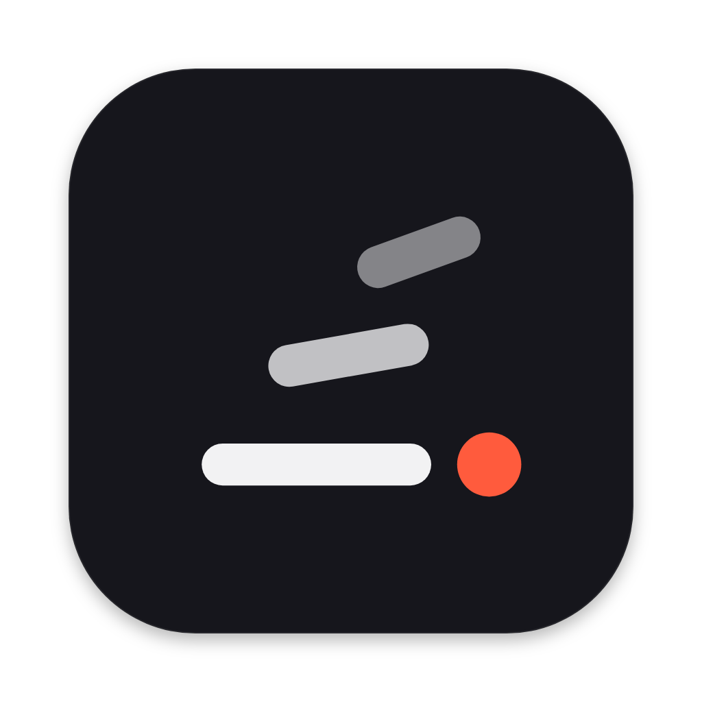

<p align="center"></p>

<h1 align="center">Wordfall</h1>

<p align="center">Hold <kbd>fn</kbd>, speak, let go. Your words appear wherever your cursor is.<br>
Local speech recognition for macOS. Nothing leaves your Mac.</p>

---

- **Push to talk anywhere.** Hold <kbd>fn</kbd> (or a right-hand modifier) in any app; release to paste.
  Double-tap for hands-free, <kbd>esc</kbd> to cancel.
- **On-device Whisper.** whisper.cpp with Metal. Large v3 Turbo by default; switch models in Settings.
- **Fast.** About 0.7 s from release to text for a typical dictation on an M-series Mac.
- **Gets your words right.** A dictionary of replacements (“post gress” → “PostgreSQL”), words to
  recognise, and suggestions learned from your transcripts.
- **No hallucinated "Thank you."** Voice activity detection drops silence, hum and typing before decoding.
- **Measured, not guessed.** A built-in benchmark harness scores engines and settings on accuracy and
  latency (see [`bench/`](bench/README.md) and [results](docs/benchmark-results.md)).

## Install

Requires macOS 13+ on Apple Silicon, Rust (stable) and Node 22+.

```sh
npm install
npm run tauri build
cp -R src-tauri/target/release/bundle/macos/Wordfall.app /Applications/
```

The bundle is signed with a local identity named in `src-tauri/tauri.conf.json`
(`bundle.macOS.signingIdentity`). Create a self-signed code-signing certificate with that name in
Keychain Access, or set your own; macOS ties permission grants to it, so a stable identity means you
grant permissions once.

On first launch Wordfall asks for:

| Permission | Why |
|---|---|
| Microphone | to hear you |
| Input Monitoring | to notice the push-to-talk key |
| Accessibility | to paste into the app you're using |

If pressing <kbd>fn</kbd> opens the emoji picker, set *System Settings → Keyboard → Press 🌐 key to → Do Nothing*
(Wordfall offers to do this for you).

## Models

Models are whisper.cpp `ggml` files, downloaded on demand into
`~/Library/Application Support/com.wordfall.app/models`. Already have some? Add their folder under
*Settings → Model → Model folders*; they're used in place, not copied.

**Settings → Data → Import from folder…** merges history, dictionary entries and suggestions from JSON
exports in any folder. Files are recognised by their structure, and model files found there are picked
up automatically.

## Development

```sh
npm run dev                     # UI in a browser against a mock backend (http://localhost:1420)
npm run tauri dev               # the real app
npm run check                   # svelte-check / TypeScript
(cd src-tauri && cargo test)    # Rust unit tests
src-tauri/target/release/wordfall bench     # accuracy/latency regression check
```

Layout:

- `src/`: Svelte 5 UI. One bundle serves both windows (the main window and the floating pill), chosen by window label.
- `src-tauri/src/`: Rust core.
  - `hotkey.rs`: listen-only event tap and the hold / tap / double-tap state machine
  - `audio.rs`: capture, metering, resampling
  - `transcribe.rs`: model catalog and whisper.cpp engine
  - `vad.rs`: silence detection
  - `postprocess.rs`: filler removal, dictionary
  - `session.rs`: record → transcribe → paste pipeline
  - `macos.rs`: permissions, paste, focus
  - `bench.rs`: benchmark harness
- `docs/ipc.md`: contract between UI and core. `DESIGN.md`: design principles and tokens.

## License

MIT. See [LICENSE](LICENSE) and [third-party notices](THIRD_PARTY_NOTICES.md).
